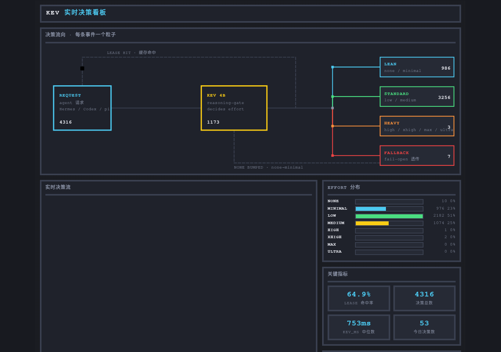
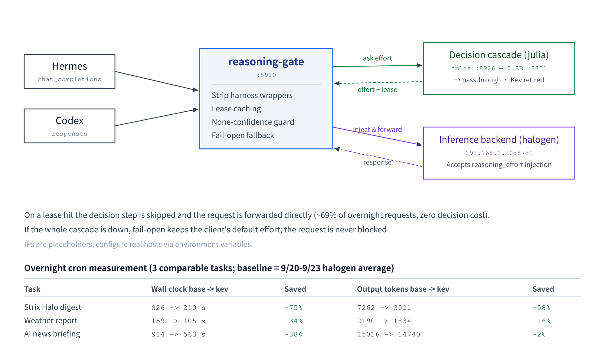

<h1 align="center">reasoning-gate</h1>

<p align="center">
  <strong>English</strong> · <a href="README_zh.md">中文</a>
</p>

An OpenAI-compatible **reasoning-effort decision layer**. It sits between an agent
(Hermes / Codex) and an inference backend (halogen / any OpenAI-compatible server
that accepts `reasoning_effort`), and uses small local decision models — today a
fine-tuned **julia-1-3B** as primary decider with a 0.8B cascade standby — to
decide, per request, how much thinking budget the next step actually needs. The
decision is injected into the backend request before forwarding. Simple tasks
think less; hard tasks think more — saving compute without sacrificing quality.





## What problem it solves

Mainstream agent harnesses (including hermes-agent) **do not send `reasoning_effort`**
to custom OpenAI-compatible endpoints — thinking is either always on or always off,
with no per-task adjustment. reasoning-gate adds that layer: every request first asks
a small decision model "what reasoning depth does the next step need", then injects
the matching effort into the backend call.

```
client (Hermes chat_completions / Codex responses)
        |
        v
   reasoning-gate :8910
        |  decision cascade (per request, with per-endpoint circuit breakers):
        |    1. julia-1-3B fine-tune  (Kev protocol /v1/systemone,  :8906)   primary
        |    2. d3-lite               (System One, NPU,            :8731)   standby
        |    3. passthrough            (keep client effort)                  last resort
        v
   backend (halogen :8731)  <-- reasoning_effort injected, then forwarded
```

> **History**: the original deployment used KEV-4B (dohnuts.cpp HIP, GPU) as the sole
> decision model. KEV-4B was decommissioned on 2026-10-07 and replaced by a
> fine-tuned julia-1-3B (see "Decision model upgrade" below); the Kev code path
> remains as legacy, enabled by setting a non-empty `KEV_URL`.

## Core features

- **Dual protocol**: handles both `/v1/chat/completions` (Hermes) and
  `/v1/responses` (Codex). Codex uses `reasoning.effort`; both shapes are read on
  input and both are written on output.
- **Decision cascade with circuit breakers**: julia (primary) → d3-lite
  (standby) → passthrough. Each endpoint has an independent breaker (5 consecutive
  failures open it, 60 s half-open probe), so a dead decider degrades gracefully
  and self-heals — verified end-to-end in production (kill julia → decider decisions
  → restart julia → auto-recover, no manual intervention).
- **Lease caching**: Kev-style answers carry "effort + how many generations it
  stays valid". The cache key is the hash of the latest user message, so growing
  tool output does not bust the cache. In Kev-era overnight runs ~69% of requests
  hit the cache with zero decision cost. (julia is trained without lease output and
  always returns lease=1 — every generation is re-evaluated; lease hits go to zero
  by design, at a cost of ~60 ms per request.)
- **Fail-open**: if the whole cascade is down / times out, the client's default
  effort is kept — the request is never blocked.
- **Harness-wrapper stripping**: before deciding, boilerplate text (cron / skill /
  memory-context wrappers) is stripped so the decider judges the real task, not
  the boilerplate. Without this, the semantic signal is diluted and confidence
  drops (measured: 0.27 → 0.66 on cron tasks after adding stripping).
- **None-confidence guard**: a wrong `none` (zero thinking) is the most damaging
  misjudgement. It requires a higher confidence threshold (`KEV_NONE_MIN_CONF`),
  otherwise it is bumped to `minimal`. (No gate applies to julia: its self-reported
  margin was measured to be uncorrelated with accuracy.)
- **Full JSONL audit**: every request is logged (decision / decider / lease_hit /
  none_bumped / state_preview / applied) for post-hoc analysis of effort
  distribution and compute savings.

## Decision model upgrade (2026-10-07): julia-1-3B > KEV-4B

An open eval set (80 real traffic cases: Hermes-cron 35 / Codex-interactive 25 /
synthetic hard cases 20), graded by 3 voters (deepseek-v4-pro, nemotron-ultra,
solar-pro-3) and 4 seats (adding the production model) — full dataset, training
and reproducible pipeline:
[effort-model-eval](https://github.com/herman6888/effort-model-eval).

| Decider | Agreement with consensus |
|---|---|
| **julia-1-3B fine-tuned (ft-v2)** | **63.7%** |
| KEV-4B (manufacturer model) | 47.5% |
| Qwen3-0.6B zero-shot base | 45.0% |

Side-by-side production spot checks agreed with julia 10/10. julia's agreement
ceiling is structural (training distribution ≈ real traffic ⇒ the model is
locally optimal in production), so it stays in production rather than a stronger
zero-shot model scoring higher on a distribution-shifted eval. Decision latency
dropped from KEV-4B's ~258 ms (GPU) to 58–146 ms on plain CPU (julia served by
`julia_serve.py`, a drop-in Kev `/v1/systemone` server — included in
[effort-model-eval](https://github.com/herman6888/effort-model-eval)); the decider
standby answers in ~277 ms on an NPU.

## Measured results (overnight cron, Kev era)

Four scheduled agent jobs were switched from the default halogen backend to
reasoning-gate (`kev-auto`). Baseline = the 9/20–9/23 halogen average per task.
Three tasks are directly comparable; the fourth (agent journal) had a model switch
inside its baseline window and is excluded.

| Task | Wall clock (base → kev) | Saved | Output tokens (base → kev) | Saved |
|---|---|---|---|---|
| Strix Halo digest | 826 s → 210 s | **−75%** | 7262 → 3021 | **−58%** |
| Weather report | 159 s → 105 s | **−34%** | 2190 → 1834 | **−16%** |
| AI news briefing | 914 s → 563 s | **−38%** | 15016 → 14740 | **−2%** |
| **Total (3 tasks)** | **1899 s → 878 s** | **−54%** | **24468 → 19595** | **−20%** |

Wall-clock savings come from lower effort levels producing shorter reasoning
blocks; output-token savings are smaller because the final answer length is
task-bound. The biggest win is on tasks confidently classified as simple (Strix
Halo: −75% wall clock). All jobs completed and delivered normally; the fail-open
path was exercised without any job failing.

## Deployment

### 1. Decision endpoints (at least one)

- **julia (primary)**: a Kev-protocol server exposing `/v1/systemone`.
  `julia_serve.py` from
  [effort-model-eval](https://github.com/herman6888/effort-model-eval) serves the
  fine-tuned julia-1-3B checkpoint (tested CPU-only, ~60 ms/decision).
- **d3-lite (standby)**: a System One `/v1/systemone` endpoint speaking the
  Kev-compatible answers schema (tested: vLLM Semantic Router Decision 3.0
  d3-lite 0.8B on an AMD NPU runtime via halogen-flash-server >= 0.18.11;
  one full-prompt pass per question, no chat/json_schema path).
- **KEV-4B (legacy)**: `/v1/systemone` as served by
  [dohnuts.cpp](https://github.com/DreamBlooms/dohnuts.cpp). Only used if
  `KEV_URL` is non-empty.

### 2. reasoning-gate

```bash
# julia primary + decider standby (recommended)
JULIA_URL=http://<julia-host>:8906/v1/systemone \
DECIDER_URL=http://<backend>:8731/v1/systemone \
DECIDER_MODEL=d3-lite \
BACKEND_CHAT=http://<backend>:8731/v1/chat/completions \
BACKEND_RESP=http://<backend>:8731/v1/responses \
python3 kev_proxy.py

# KEV-4B legacy mode only
KEV_URL=http://<kev-host>:8905/v1/systemone \
BACKEND_CHAT=http://<backend>:8731/v1/chat/completions \
python3 kev_proxy.py
```

### 3. systemd (Linux)

```bash
# edit Environment= paths/addresses in kev-proxy.service
cp kev-proxy.service ~/.config/systemd/user/
systemctl --user daemon-reload
systemctl --user enable --now kev-proxy
```

### 4. Register as a selectable model

**Hermes** (top-level `model_aliases:` in config.yaml — a direct alias is required
for `-m kev-auto` to route correctly; a plain `custom_providers` entry is silently
ignored by the CLI):
```yaml
model_aliases:
  kev-auto:
    model: kev-auto
    provider: kev-proxy
    base_url: http://127.0.0.1:8910/v1
    api_key: kev-local
```

**Codex** (`~/.codex/config.toml` + `model_catalog.json`):
```toml
[model_providers.kev]
name = "kev (auto effort via julia cascade)"
base_url = "http://127.0.0.1:8910/v1"
wire_api = "responses"
requires_openai_auth = false
```

**Pin a cron job**: `hermes cron edit <id> --model kev-auto --provider kev-proxy`

## Configuration (environment variables)

| Variable | Default | Description |
|---|---|---|
| `JULIA_URL` | *(empty = disabled)* | julia decision service (`/v1/systemone`, Kev protocol) |
| `JULIA_TIMEOUT` | `5` | julia timeout (seconds) |
| `DECIDER_URL` | *(empty = disabled)* | standby decider, OpenAI chat-completions endpoint |
| `DECIDER_MODEL` | `d3-lite` | model name for the standby decider |
| `DECIDER_TIMEOUT` | `10` | standby decider timeout (seconds) |
| `KEV_URL` | `http://192.168.1.10:8905/v1/systemone` | KEV-4B legacy service; **set empty to disable the Kev path entirely** |
| `BACKEND_CHAT` | `http://192.168.1.20:8731/v1/chat/completions` | Backend chat endpoint |
| `BACKEND_RESP` | `http://192.168.1.20:8731/v1/responses` | Backend responses endpoint |
| `BACKEND_MODEL` | `halogen-qwen3.8-flash-next` | Real model name forwarded to backend |
| `KEV_DEFAULT_EFFORT` | `medium` | Fallback when no client effort is given |
| `KEV_LOG` | `~/.hermes/kev-proxy/decisions.jsonl` | Decision audit log path |
| `KEV_LEASE_CAP` | `5` | Max generations a lease stays valid |
| `KEV_NONE_MIN_CONF` | `0.55` | Min confidence required to judge `none` |

Effort mapping follows the halogen contract: `minimal/low/medium/high/xhigh` +
`none` (the chat template folds to three tiers: minimal,low→low; high,xhigh→xhigh).

## Known limitations

- Decision models are **text-semantic** and blind to numeric state; numeric
  threshold decisions should be plain code, not a decision model.
- julia's agreement ceiling (63.7%) is set by voter consensus, and it starves on
  extreme tiers in small samples (medium 0/5, high 0/1) — production monitoring
  covers this. Its self-reported margin is uncorrelated with accuracy, so no
  confidence gate applies to it.
- The decision step adds latency (julia ~60 ms CPU, decider ~277 ms NPU, legacy Kev
  ~258 ms GPU); with julia's lease fixed at 1 every generation is re-decided.
- Savings concentrate on tasks with a clear simple/complex split. On tasks that are
  genuinely complex end to end (AI news briefing: −2% output tokens), the gate
  mostly avoids *extra* thinking rather than removing needed thinking.

## License

MIT
