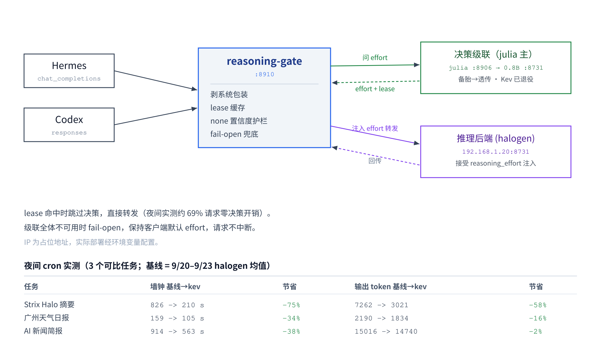

<h1 align="center">reasoning-gate</h1>

<p align="center">
  <strong>中文</strong> · <a href="README.md">English</a>
</p>

一个 OpenAI 兼容的 **reasoning-effort 决策中间层**。它坐在 agent（Hermes / Codex）
和推理后端（halogen / 任何接受 `reasoning_effort` 的 OpenAI 兼容服务）之间，
用小决策模型——当前是**微调 julia-1-3B 主判 + 0.8B 级联备胎**——对每个请求实时判断
「这次该用多少思考预算」，把判定注入后端请求后转发。目标：简单任务少想、复杂任务多想，
省算力而不牺牲质量。



```
client (Hermes chat_completions / Codex responses)
        │
        ▼
   reasoning-gate :8910
        │  决策级联（每请求，端点各有独立熔断器）：
        │    1. julia-1-3B 微调    (Kev 协议 /v1/systemone，:8906)   主判
        │    2. decider-0.8b       (OpenAI json_schema，NPU，:8731)  备胎
        │    3. passthrough        (保持客户端 effort)               兜底
        ▼
   后端 (halogen :8731)  ← 注入 reasoning_effort 后转发
```

> **历史**：最初部署用 KEV-4B（dohnuts.cpp HIP，GPU）作为唯一决策模型。
> KEV-4B 已于 2026-10-07 退役，由微调 julia-1-3B 接替（见下文「决策模型升级」）；
> Kev 代码路径保留为 legacy，设置非空 `KEV_URL` 即启用。

## 它解决什么问题

主流 agent harness（包括 hermes-agent）对自定义 OpenAI 兼容端点**不会**发送
`reasoning_effort`——要么全开思考、要么全关，无法按任务难度调节。reasoning-gate 补上
这一层：每个请求先问一次小决策模型「下一步需要的推理深度」，再把对应的 effort
塞给后端。

## 核心特性

- **双协议**：同时吃 `/v1/chat/completions`（Hermes）和 `/v1/responses`（Codex）。
  Codex 的 effort 字段是 `reasoning.effort`，读取时两种形状都兼容，回写时都设。
- **决策级联 + 独立熔断**：julia（主）→ decider-0.8b（备胎）→ passthrough。
  每个端点独立熔断（连续 5 次失败打开，60s 半开探测），决策端挂了自动降级、
  恢复自愈——生产实测端到端验证过（杀 julia → 落 decider 决策 → 拉起 julia → 自动回主链路）。
- **lease 缓存**：Kev 风格的答案带「effort + 有效代数」，缓存 key 锚定最新一条
  用户消息的 hash，工具输出增长不会击穿缓存。Kev 时代夜间实测 ~69% 请求命中缓存。
  （julia 训练时没学 lease，固定返回 lease=1——每代重新评估，lease 命中归零是设计
  使然，代价约 60ms/请求。）
- **fail-open**：级联全体挂了 / 超时 → 保持客户端默认 effort，绝不阻断请求。
- **系统包装剥离**：决策前剥掉 cron / skill / memory-context 等 harness 样板文本，
  让决策模型判断真实任务而非 boilerplate（否则语义信号被稀释，置信度从 0.66 骤降到 0.27）。
- **none 护栏**：`none`（零思考）误判代价最高，要求更高置信度，否则自动升到 `minimal`。
  （julia 不设置信度闸门：实测其自报 margin 与正确率不相关。）
- **全量审计**：每个请求写 JSONL（decision / decider / lease_hit / none_bumped /
  state_preview / applied），供事后分析 effort 分布与算力节省。

## 决策模型升级（2026-10-07）：julia-1-3B > KEV-4B

公开评测集（80 个真实流量样本：Hermes-cron 35 / Codex-交互 25 / 合成困难 20），
3 评委（deepseek-v4-pro、nemotron-ultra、solar-pro-3）+ 4 席位（加入生产模型）投票定标，
数据集、训练、流水线全可复现：
[effort-model-eval](https://github.com/herman6888/effort-model-eval)。

| 决策模型 | 与共识一致率 |
|---|---|
| **julia-1-3B 微调（ft-v2）** | **63.7%** |
| KEV-4B（厂商模型） | 47.5% |
| Qwen3-0.6B 零样本基座 | 45.0% |

生产并排抽查 julia 10/10 全对。julia 的一致率上限是结构性的（训练分布 ≈ 生产流量
分布 ⇒ 在生产分布上局部最优），因此上生产的是它而不是评测集上更高分的零样本模型。
决策延迟从 KEV-4B 的 ~258ms（GPU）降到纯 CPU 58–146ms（`julia_serve.py`，Kev
`/v1/systemone` 协议即插即用服务，收录在
[effort-model-eval](https://github.com/herman6888/effort-model-eval)）；decider 备胎
在 NPU 上 ~277ms。

## 夜间实测（整夜 cron + 交互会话，Kev 时代）

四个定时 agent 任务从默认 halogen 后端切到 reasoning-gate（kev-auto）。基线 = 各任务
9/20–9/23 的 halogen 均值。其中三个任务可直接对比；第四个（agent 日志）基线窗口内
发生过模型切换，不纳入对比。

| 任务 | 墙钟（基线→kev） | 节省 | 输出 token（基线→kev） | 节省 |
|---|---|---|---|---|
| Strix Halo 摘要 | 826 s → 210 s | **−75%** | 7262 → 3021 | **−58%** |
| 广州天气日报 | 159 s → 105 s | **−34%** | 2190 → 1834 | **−16%** |
| AI 新闻简报 | 914 s → 563 s | **−38%** | 15016 → 14740 | **−2%** |
| **合计（3 任务）** | **1899 s → 878 s** | **−54%** | **24468 → 19595** | **−20%** |

墙钟节省来自更低 effort 产生更短的 thinking 块；输出 token 节省较小，因为最终答案
长度受任务本身约束。最大收益出现在被高置信判为简单的任务上（Strix Halo：墙钟 −75%）。
改进后（剥包装 + lease 收紧 + none 护栏）：cron 任务置信度从 0.27 升到 0.66。

## 部署

### 1. 决策端点（至少配一个）

- **julia（主判）**：暴露 `/v1/systemone` 的 Kev 协议服务。
  [effort-model-eval](https://github.com/herman6888/effort-model-eval) 里的
  `julia_serve.py` 直接服务 julia-1-3B 微调权重（实测纯 CPU，决策 ~60ms）。
- **decider-0.8b（备胎）**：任何支持 `response_format` json_schema + `logprobs` 的
  OpenAI 兼容端点（实测：AMD NPU 运行时上的 0.8B 分类器，经 halogen-flash-server）。
- **KEV-4B（legacy）**：[dohnuts.cpp](https://github.com/DreamBlooms/dohnuts.cpp)
  提供的 `/v1/systemone`。仅当 `KEV_URL` 非空时启用。

### 2. reasoning-gate

```bash
# julia 主判 + decider 备胎（推荐）
JULIA_URL=http://<julia-host>:8906/v1/systemone \
DECIDER_URL=http://<backend>:8731/v1/chat/completions \
DECIDER_MODEL=decider-0.8b \
BACKEND_CHAT=http://<backend>:8731/v1/chat/completions \
BACKEND_RESP=http://<backend>:8731/v1/responses \
python3 kev_proxy.py

# 纯 KEV-4B legacy 模式
KEV_URL=http://<kev-host>:8905/v1/systemone \
BACKEND_CHAT=http://<backend>:8731/v1/chat/completions \
python3 kev_proxy.py
```

### 3. systemd（Linux）

```bash
# 改 kev-proxy.service 里的 Environment= 路径与地址
cp kev-proxy.service ~/.config/systemd/user/
systemctl --user daemon-reload
systemctl --user enable --now kev-proxy
```

### 4. 注册成可选模型

**Hermes**（config.yaml 顶层 `model_aliases:`，direct alias 才能让 `-m kev-auto` 生效）：
```yaml
model_aliases:
  kev-auto:
    model: kev-auto
    provider: kev-proxy
    base_url: http://127.0.0.1:8910/v1
    api_key: kev-local
```

**Codex**（`~/.codex/config.toml` + `model_catalog.json`）：
```toml
[model_providers.kev]
name = "kev (auto effort via julia cascade)"
base_url = "http://127.0.0.1:8910/v1"
wire_api = "responses"
requires_openai_auth = false
```

**cron 钉模型**：`hermes cron edit <id> --model kev-auto --provider kev-proxy`

## 配置项（环境变量）

| 变量 | 默认 | 说明 |
|---|---|---|
| `JULIA_URL` | *（空 = 禁用）* | julia 决策服务地址（`/v1/systemone`，Kev 协议） |
| `JULIA_TIMEOUT` | `5` | julia 超时（秒） |
| `DECIDER_URL` | *（空 = 禁用）* | 备胎决策端点（OpenAI chat/completions） |
| `DECIDER_MODEL` | `decider-0.8b` | 备胎决策模型名 |
| `DECIDER_TIMEOUT` | `10` | 备胎超时（秒） |
| `KEV_URL` | `http://192.168.1.10:8905/v1/systemone` | KEV-4B legacy 地址；**置空即整条 Kev 路径禁用** |
| `BACKEND_CHAT` | `http://192.168.1.20:8731/v1/chat/completions` | 后端 chat 端点 |
| `BACKEND_RESP` | `http://192.168.1.20:8731/v1/responses` | 后端 responses 端点 |
| `BACKEND_MODEL` | `halogen-qwen3.8-flash-next` | 转发给后端的真实模型名 |
| `KEV_DEFAULT_EFFORT` | `medium` | 无客户端 effort 时的兜底 |
| `KEV_LOG` | `~/.hermes/kev-proxy/decisions.jsonl` | 决策审计日志路径 |
| `KEV_LEASE_CAP` | `5` | lease 有效代数上限 |
| `KEV_NONE_MIN_CONF` | `0.55` | 判 `none` 所需的最低置信度 |

effort 映射遵循 halogen 契约：`minimal/low/medium/high/xhigh` + `none`
（chat template 折叠成三档：minimal,low→low；high,xhigh→xhigh）。

## 已知局限

- 决策模型是**文本语义**模型，对数值状态失明；数值阈值判断应写普通代码。
- julia 的一致率上限（63.7%）由评委共识决定，小样本极端档位饥饿（medium 0/5、
  high 0/1），靠生产监控兜底；其自报 margin 与正确率不相关，故不设置信度闸门。
- 决策本身有延迟（julia ~60ms CPU、decider ~277ms NPU、legacy Kev ~258ms GPU）；
  julia lease 固定为 1，每代都会重新决策。
- 收益集中在简/繁分界清晰的任务。真正全程复杂任务（AI 新闻简报：输出 token −2%）
  上，gate 主要避免的是*多余的*思考，不是砍掉必要的思考。

## License

MIT
